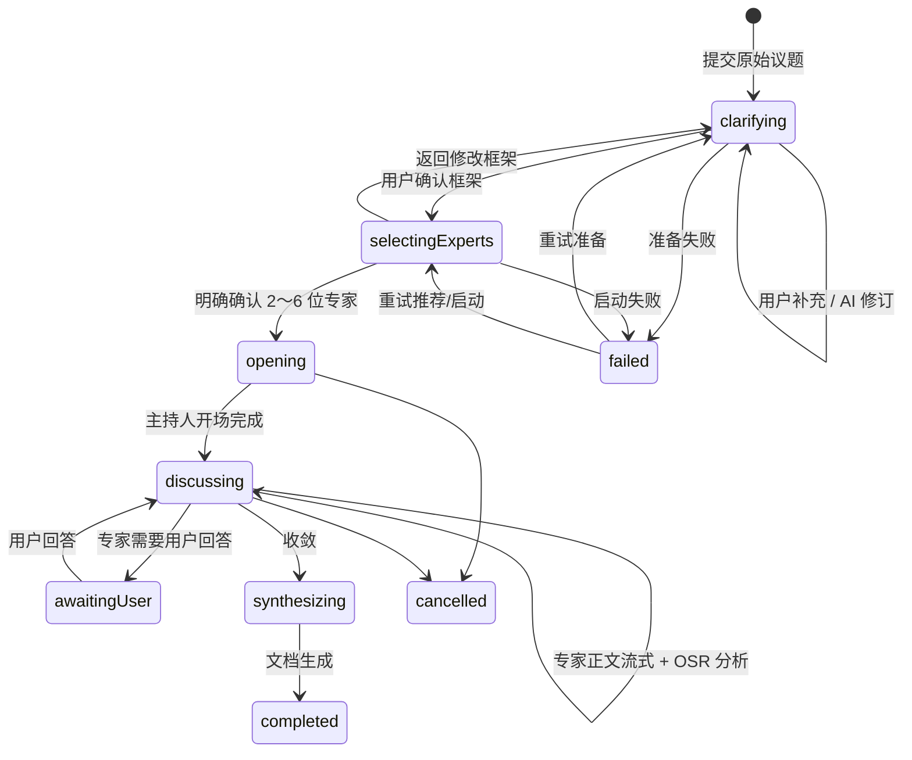

# Architecture Design：专家圆桌准备室与真流式发言（产品交互约束）

> 目标版本：1.200.0-rc1  
> 状态：产品侧架构建议，待 Goal Lead 结合实现审定  
> Owner：产品-议题准备流程规格  
> 注意：本文描述必须成立的状态、数据与事件语义，不声称代码已实现。

## 1. 设计原则

1. **确认先于执行**：准备模型只能写建议稿；用户明确确认才产生启动讨论事件。
2. **正文先于结构化**：用户可见正文走稳定文本流；OSR 分析只读完整正文。
3. **草稿与消息分离**：流式草稿有独立生命周期，不把半截消息混入正式 transcript。
4. **恢复从严**：未知、矛盾或不完整状态恢复到可解释的准备/失败状态，不猜测用户已经确认。
5. **新增字段向后兼容**：旧 raw value、旧阶段和旧消息无需迁移即可打开。

## 2. 建议状态机



实现约束：

- `clarifying` 和 `selectingExperts` 应是可持久化、可路由的明确阶段，而非仅 View 本地布尔值。
- 新建报告只进入 `clarifying`；现有“创建即 drive”调用必须拆开。
- `confirmStart` 是进入 `opening` 的唯一业务事件，同时校验框架版本和 2～6 人。
- 历史阶段不改变语义；旧报告的 `opening/discussing/...` 直接走旧恢复路径。

## 3. 建议数据边界

### 3.1 准备模型

建议增加可选、可安全解码的准备数据：

```text
RoundtablePreparation
├── originalTopic
├── refinedTitle
├── coreQuestion
├── frameworkRevision
├── frameworkItems[3...5]
├── clarificationMessages[]
├── clarificationQuestions[1...3]
├── recommendations[]
├── selectedExperts[2...6]
├── frameworkConfirmedAt?
└── expertsConfirmedAt?
```

关键语义：

- `originalTopic` 永不被模型覆盖。
- `frameworkRevision` 每次 AI 修订递增；开始命令携带或校验当前 revision，防止旧建议迟到覆盖新确认。
- `recommendations` 与 `selectedExperts` 分离。推荐刷新不得删除用户手选角色。
- 推荐项至少包含 `role`、`reason`；角色未知时忽略并记录缺口，不因单项错误让整份建议失败。
- 用户确认时间是审计证据；缺失时不得从 `selectingExperts` 恢复为 `opening`。

### 3.2 流式草稿

建议报告包含单一可选草稿：

```text
RoundtableStreamingDraft
├── messageID
├── role
├── round
├── content
├── state: speaking | analyzing | interrupted
├── startedAt
└── lastCheckpointAt?
```

约束：

- `messageID` 在一次专家尝试中稳定，正式化时沿用，用于幂等和重试去重。
- UI 增量可以是内存态；正文完成、取消/中断处理、阶段迁移必须有确定落盘点。
- 任何时刻至多一个草稿，且草稿角色应与 `activeExpert` 一致；矛盾恢复为 interrupted/failed，不自动续写。

## 4. 事件与副作用顺序

### 4.1 准备阶段

```text
submitOriginalTopic
  → create report(clarifying)
  → persist
  → requestPreparation
  → validate payload
  → merge suggestion without deleting user choices
  → persist
```

### 4.2 明确开始

```text
confirmStart(expectedFrameworkRevision, selectedRoles)
  → validate current phase == selectingExperts
  → validate revision is current
  → validate unique roles count in 2...6
  → persist confirmation and opening phase atomically
  → start engine
```

任何校验失败都留在选人页并返回用户可见错误，不能先启动再回滚。

### 4.3 专家发言

```text
startExpertTurn(stableMessageID)
  → set activeExpert + empty speaking draft
  → free-text stream
  → throttle visible deltas
  → finalize formal message atomically
  → set draft.state = analyzing
  → structured OSR analysis(full text)
  → attach OSR / fallback undecided
  → clear draft + activeExpert
  → continue engine
```

正文模型和分析模型可共享人设与议题上下文，但分析 prompt 必须把正文作为惰性数据，禁止让正文中的“指令”改变工具或应用行为。

## 5. 路由与恢复建议

| 持久化状态 | 打开历史时目标页面 | 恢复动作 |
| --- | --- | --- |
| `clarifying` | 准备室 | 恢复原始议题、对话、最新建议；不自动发请求，除非明确标记上次请求可安全重试。 |
| `selectingExperts` | 专家阵容 | 恢复框架、推荐、用户选择和人数提示；不自动开始。 |
| `opening/discussing/awaitingUser/synthesizing` | 讨论页 | 沿用现有路径；检查草稿一致性后再决定显示中断或继续。 |
| `completed` | 文档页或历史详情 | 沿用现有文档路径与保存错误展示。 |
| `failed/cancelled` | 最后安全页面 | 根据失败来源显示重试目标；默认不扩大状态。 |
| 未知新阶段/矛盾数据 | 准备室或失败页 | 显示恢复提示，要求用户重新确认；不得推断已确认。 |

## 6. 并发、取消与迟到结果

- 每次准备修订与每次专家发言都应有 generation/run 标识。
- 用户提交新补充后，旧准备响应迟到只能被丢弃，不能覆盖新 revision。
- 用户移除专家后，旧推荐响应可更新理由，但不能重新勾选该专家。
- 取消流式任务后，迟到 delta、finish 或 OSR 结果必须按 run ID 丢弃。
- 相同 `messageID` 的正式化操作幂等；重试不能追加第二条同内容消息。

## 7. 性能与持久化建议

- 用缓冲器合并 delta，主线程刷新目标 50～100ms 一次。
- 不调用现有“每次 mutate 都持久化”的路径处理每个 token；需要 transient UI update 或带 `persist: false` 的受控更新。
- 可选每约 1 秒写入低频检查点，但不得阻塞主线程；若实现复杂，首版可以只在完成/中断时落盘。
- 流式完成到正式消息的替换应一次写入，避免界面同时显示草稿和重复正式消息。

## 8. 降级策略

| 失败点 | 产品允许的安全降级 |
| --- | --- |
| 准备 payload 部分无效 | 显示有效部分与缺口；用户可重试。框架未达 3 项时不可确认。 |
| 推荐完全失败 | 允许用户在完整专家池手选 2～6 位；显示“推荐暂不可用”。 |
| 文本模型不提供增量 | 显示真实加载状态；整段完成后一次出现，但不得伪造打字动画。记录能力降级供 QA 判断。 |
| 正文中断 | 已有内容保留为中断草稿或记录；明确重试，不复制正式消息。 |
| OSR 失败 | 正文正式化，立场设为待定；看板显示“分析失败/可重试”。 |
| 持久化失败 | 界面明确提示未保存；不声称可恢复。 |

## 9. 对 Goal Lead 的实现约束

1. 不要把准备阶段实现成只存在于 SwiftUI 的临时 sheet；历史恢复需要持久化。
2. 不要继续复用“结构化输出中的 `speaking` 字段”来模拟流式；它正是当前一次性出现的根因。
3. 不要解析半截 JSON 或 tool-call arguments 生成正文。
4. 不要让 `startAgentRoundtable` 在创建报告后立即 `driveRoundtable`。
5. 不要在选人页通过默认焦点、Enter 或页面恢复自动调用开始。
6. 不要逐 token 调用同步持久化。
7. 新增角色需保留既有角色 raw value；旧数据的阶段与消息字段必须有安全默认值。
8. `L10n.swift` 已接近文件上限，新文案应进入独立 Roundtable Setup 扩展/资源。
