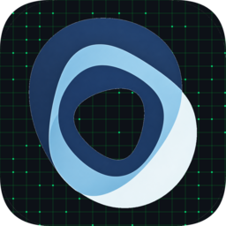
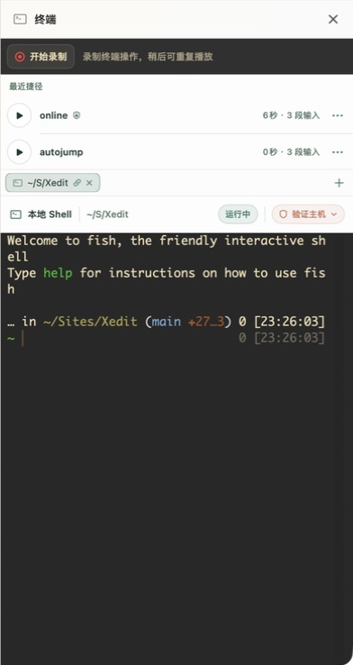
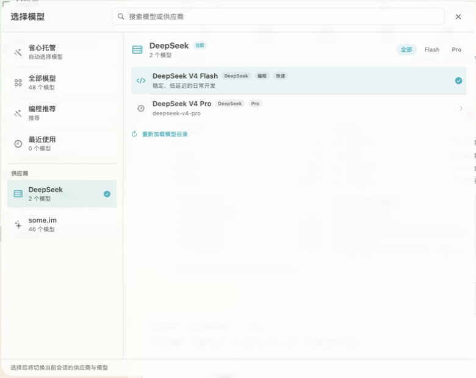

# WillDeep

**让 AI 从建议走向执行与交付。**

面向 macOS 的开源 Agent 工作台，将任务规划、多 Agent 协作、工具执行与结果审查连接在同一个原生应用中。

**[下载 WillDeep](https://willdeep.com)** · [阅读使用指南](docs/willdeep-tutorial/README.md) · [从源码构建](docs/DEVELOPMENT.md)

**简体中文** · [English](#willdeep) · [日本語](#willdeep-日本語版)

---

## 一个目标，一个完整的工作现场

从修复问题到实现功能，从代码审查到远端项目维护，真正的工作不止于一段回答。它需要理解上下文、操作工具、跟踪进度，并留下可以核对的结果。

WillDeep 以任务为中心，把会话、工作区、终端、文件变更和执行结果组织在一起。你可以继续使用熟悉的编辑器，让 Agent 在明确的工作范围内推进任务，并在同一处查看它做了什么、哪里需要决定、哪些结果已经得到验证。

### 从目标到结果

1. **明确目标**：选择工作区和模型，描述预期结果；复杂任务可使用计划或 Goal 模式分阶段推进。
2. **协调执行**：Agent 调用文件、终端和其他工具，也可委派 Worker 或外部执行器处理子任务。
3. **核对交付**：查看 Diff、测试输出和产物，依据证据判断结果，而不是只依赖完成声明。

## 为真实任务设计

### 长任务，保持连续的工作上下文

Goal 模式支持阶段规划，结合上下文压缩、任务状态与预算管理，帮助 Agent 在多轮执行中持续围绕目标工作。后台任务和事件通知让等待与后续处理进入同一条任务流程。

你可以查看进度、调整方向或停止执行。恢复能力依任务类型与执行器而异，不代表所有外部操作都可以无损重放。

### 多 Agent 协作，集中掌握进展

将调查、实现、验证与审查分配给不同 Worker，在同一工作台查看子任务状态和工具活动。模型档位与职责配置让不同工作采用适合的执行资源。

WillDeep 也可连接 Codex CLI、Claude Code 等外部执行器，让已有工具成为工作流的一部分，而不是要求你重新选择整套工具链。

### 本地与远端，延续熟悉的工作方式

工作区可以位于本机，也可以通过 SSH 或自建 `willdeep-agent` daemon 连接远端环境。项目文件、命令执行和结果审查围绕所选工作区展开。

终端、Diff、文件预览和网页面板集中呈现，并支持独立窗口。你不必在多个应用之间反复搬运任务上下文。

### 模型与扩展，由你选择

使用 some.im 托管服务，或配置自己的 API Key、自定义 Provider 与本地模型。通过 Skills、MCP、工作流和插件，将现有工具与团队实践接入任务流程。

定时任务可承接重复工作；媒体工具与插件则把工作台延伸到代码之外。具体能力取决于所选模型、已安装扩展及运行环境。

### 自主执行，有清晰的控制边界

审批模式、工作区边界、沙箱、凭据管理与执行记录共同支持受控执行。已授权范围内的操作可持续推进，需要额外授权或业务决定时再由你介入。

这些机制用于降低误操作风险，不构成“零风险”承诺。连接远端服务或使用更高权限前，请确认相应配置与访问范围。

## 看见执行，也看见结果

| 任务与控制 | 可见终端 | 模型选择 |
| --- | --- | --- |
|  |  |  |

*以上为项目教程中的真实界面截图；不同版本、账号和配置下的界面可能有所差异。*

## 适合这些工作

- **开发与维护**：理解项目、定位问题、修改代码、运行检查，并查看变更。
- **复杂任务推进**：拆分阶段、委派子任务，在统一视图中跟踪执行与待处理事项。
- **远端项目操作**：连接 SSH 或 daemon 工作区，在本机查看远端执行过程与结果。
- **重复流程与内容工作**：结合定时任务、工作流、MCP 和媒体工具组织日常工作。

## 开始你的第一个任务

1. 从 [官网](https://willdeep.com) 获取 macOS 版本，或按 [开发指南](docs/DEVELOPMENT.md) 从源码构建。系统要求为 macOS 13.7 及以上。
2. 配置模型来源，选择本地或远端工作区，并确认审批模式。
3. 描述一个具体、可验证的目标，例如：“修复这个项目中导致登录失败的问题，补充回归测试，并说明修改内容。”

[快速开始](docs/willdeep-tutorial/01-quick-start.md) · [完整图文教程](docs/willdeep-tutorial/README.md) · [构建与测试](docs/DEVELOPMENT.md)

## 开放核心，透明边界

WillDeep 的核心代码按 [Apache License 2.0](LICENSE) 开源。你可以阅读实现、从源码构建，并根据许可证使用和修改代码；商业产品与服务边界见 [Open Core 说明](OPEN_CORE.md)。

本地工作区不等于数据始终留在本机：使用云端模型或外部工具时，请求所需的上下文可能发送给对应服务。请根据项目的数据要求选择模型、工具和权限配置。

项目持续迭代。仓库版本、预发布版本与公开下载版本可能不同；具体变化见 [CHANGELOG](CHANGELOG.md)，当前实现状态和已知限制见 [Product Overview](product-overview.md)。测试通过的单项能力不代表所有长任务、恢复路径或整体验收场景均已覆盖。

## 一起完善 Agent 的工作方式

欢迎提交 [Issue](https://github.com/niuwoai/willdeep/issues) 反馈使用场景、问题或建议，也欢迎通过 Pull Request 贡献代码与文档。开发约定和测试入口见 [开发指南](docs/DEVELOPMENT.md)。

**[下载 WillDeep，开始一个真实任务](https://willdeep.com)**

---

# WillDeep · English

**Bring AI from answers to execution and delivery.**

WillDeep is an open-source, native macOS agent workspace that brings planning, multi-agent collaboration, tool execution, and result review into one application.

**[Download WillDeep](https://willdeep.com)** · [User guide](docs/willdeep-tutorial/README.md) · [Build from source](docs/DEVELOPMENT.md)

[简体中文](#willdeep-中文版) · **English** · [日本語](#willdeep-日本語版)

## One goal. A connected workspace.

Real work involves more than a response. It requires project context, tool access, progress tracking, and results you can inspect.

WillDeep organizes conversations, workspaces, terminals, file changes, and execution results around the task. Keep your preferred editor, give the agent a defined scope, and review what changed without reconstructing the work across disconnected windows.

## Built for work beyond a single turn

- **Long-running tasks:** Use plans and Goal mode to organize stages, with context compression, task state, and budget controls supporting continued execution.
- **Multi-agent collaboration:** Delegate research, implementation, verification, and review to Workers. Connect external executors such as Codex CLI and Claude Code.
- **Local and remote workspaces:** Work with local projects, SSH environments, or a self-hosted `willdeep-agent` daemon, with terminals and results visible on your Mac.
- **Model and tool choice:** Use some.im managed services, your own API keys, custom providers, or local models. Extend workflows through Skills, MCP, plugins, and scheduled tasks.
- **Controlled execution:** Configure approval modes, workspace boundaries, and sandbox permissions. Inspect diffs, test output, artifacts, and execution records.

Recovery support varies by task and executor. These controls reduce risk; they do not guarantee lossless recovery or risk-free execution.

## Start with a concrete outcome

1. Download the macOS app or build from source. Requires macOS 13.7 or later.
2. Configure a model, select a workspace, and review the approval mode.
3. Describe an outcome you can verify: “Fix the login failure in this project, add a regression test, and explain the changes.”

[Quick start](docs/willdeep-tutorial/01-quick-start.md) · [Tutorials](docs/willdeep-tutorial/README.md) · [Development guide](docs/DEVELOPMENT.md) — linked guides are currently in Chinese.

## Open code. Clear boundaries.

The core is available under [Apache License 2.0](LICENSE). See [Open Core](OPEN_CORE.md) for commercial product and service boundaries.

A local workspace does not mean all data stays on your device. Cloud models and external tools may receive the context needed for their requests. Choose providers and permissions according to your project's requirements.

Development, prerelease, and public download versions may differ. Consult the [changelog](CHANGELOG.md) and [product status](product-overview.md) for implementation details and known limitations. Passing individual tests does not establish complete coverage of long-running tasks, recovery, or end-to-end acceptance.

[Report an issue](https://github.com/niuwoai/willdeep/issues) · [Contribute](docs/DEVELOPMENT.md) · **[Download WillDeep](https://willdeep.com)**

---

# WillDeep · 日本語

**AI の回答を、実行と成果につなげる。**

WillDeep は、計画、マルチエージェント連携、ツールの実行、結果の確認を一つにまとめた、オープンソースの macOS ネイティブ Agent ワークスペースです。

**[WillDeep をダウンロード](https://willdeep.com)** · [利用ガイド](docs/willdeep-tutorial/README.md) · [ソースからビルド](docs/DEVELOPMENT.md)

[简体中文](#willdeep-中文版) · [English](#willdeep) · **日本語**

## 目標を中心に、作業をひとつにつなぐ

実際の仕事には、回答だけでなく、プロジェクトの理解、ツール操作、進捗管理、確認できる成果が必要です。

WillDeep は、会話、ワークスペース、ターミナル、ファイルの変更、実行結果をタスクごとに整理します。使い慣れたエディタはそのままに、明確な範囲で Agent に作業を任せ、変更内容や判断が必要な箇所を確認できます。

## 一回の対話で終わらない仕事に

- **長時間のタスク**：計画と Goal モードで段階を整理し、コンテキスト圧縮、タスク状態、予算管理を使って継続的な実行を支援します。
- **複数 Agent の連携**：調査、実装、検証、レビューを Worker に委任できます。Codex CLI や Claude Code などの外部実行ツールにも対応します。
- **ローカルとリモート**：ローカルのプロジェクト、SSH 環境、自分で運用する `willdeep-agent` daemon を接続し、Mac 上で実行状況と結果を確認できます。
- **モデルと拡張の選択**：some.im のマネージドサービス、自分の API キー、カスタム Provider、ローカルモデルを選択できます。Skills、MCP、プラグイン、ワークフロー、定期実行で用途を広げられます。
- **実行範囲の管理**：承認モード、ワークスペース境界、サンドボックス権限を設定し、Diff、テスト出力、成果物、実行記録を確認できます。

復旧への対応はタスクや実行ツールによって異なります。これらの仕組みはリスクを減らすためのもので、完全な復旧や無リスクの実行を保証するものではありません。

## 最初のタスクを始める

1. macOS アプリをダウンロードするか、ソースからビルドします。macOS 13.7 以降が必要です。
2. モデルとワークスペースを選択し、承認モードを確認します。
3. 「ログインに失敗する原因を修正し、回帰テストを追加して、変更内容を説明してください」のように、確認可能な目標を伝えます。

[クイックスタート](docs/willdeep-tutorial/01-quick-start.md) · [チュートリアル](docs/willdeep-tutorial/README.md) · [開発ガイド](docs/DEVELOPMENT.md) — リンク先のガイドは現在中国語です。

## オープンなコード、明確な境界

コアコードは [Apache License 2.0](LICENSE) で公開されています。商用製品・サービスとの区分は [Open Core](OPEN_CORE.md) を参照してください。

ローカルのワークスペースでも、すべてのデータが端末内に留まるとは限りません。クラウドモデルや外部ツールには、リクエストに必要なコンテキストが送信される場合があります。プロジェクトの要件に合わせて接続先と権限を選択してください。

開発版、プレリリース版、公開ダウンロード版は異なる場合があります。[変更履歴](CHANGELOG.md) と [実装状況](product-overview.md) で対応範囲と既知の制限を確認してください。個別テストの成功は、すべての長時間タスク、復旧経路、全体の受け入れ検証を網羅したことを意味しません。

[Issue を報告](https://github.com/niuwoai/willdeep/issues) · [開発に参加](docs/DEVELOPMENT.md) · **[WillDeep をダウンロード](https://willdeep.com)**
