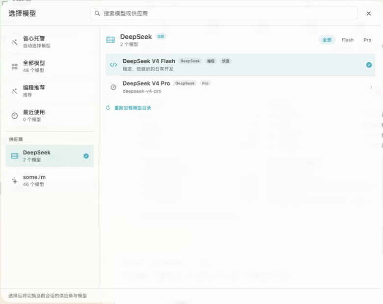

# 第 3 章：模型、任务模式与审批

[上一章：工作区与会话](02-workspaces-sessions.md) · [返回索引](README.md) · [下一章：侧栏与审查](04-side-panels-review.md)

## 1. 选择模型

点击输入区底部的模型名称，会打开模型选择器：

选择器通常提供：

- 省心托管：根据任务自动选择模型。
- 全部模型：浏览账号可用的完整目录。
- 编程推荐：面向代码任务的筛选入口。
- 最近使用：快速回到近期模型。
- 供应商列表：按 DeepSeek、some.im 或已配置 provider 分类。

选择模型后，只会切换当前会话的供应商与模型。若模型目录刚更新，可点击“重新加载模型目录”。

## 2. 模型选择建议

- 日常搜索、改小文件、格式转换：优先快速模型。
- 跨模块重构、复杂推理、长文档：使用能力更强的 Pro 模型。
- 图片理解：确保主模型支持图片输入，或配置专用视觉模型。
- 代码任务：优先选择标有编程推荐的模型，并给出测试命令。
- 自动化：选择稳定、成本可控的模型，避免每 15 分钟请一位院士来抄日报。

## 3. 执行器

输入区上方的执行器菜单用于选择这一轮由谁执行：

- “我们”：使用 WillDeep 内置 Agent 主链路。
- Claude Code：委托给本机 Claude Code CLI。
- Codex CLI：委托给本机 Codex CLI。
- 其他已发现的本地 Agent：取决于设置中的可执行器发现结果。

外部执行器仍应受到工作区和审批边界约束。第一次使用前，到设置的 Runtimes/Local Agents 页面确认 CLI 是否已安装和可发现。

## 4. 普通、计划与目标模式

点击“普通”模式菜单可以选择：

- 普通：直接分析并执行，适合范围明确的小任务。
- 计划：先形成步骤，写入被锁定，批准计划后再执行。
- 目标：把长期目标和清单固定到后续每轮中，适合持续推进。

建议选择：

| 场景 | 推荐模式 |
|---|---|
| 改一个文案、查一个错误 | 普通 |
| 跨多个文件的功能开发 | 计划 |
| 迁移系统、长期内容生产 | 目标 |
| 生产事故只做诊断 | 普通，并明确“不要修改” |

计划模式中先检查步骤是否覆盖测试、回滚和交付物。批准计划并不等于批准所有高风险动作；删除、发布和生产变更仍可能再次请求确认。

## 5. 三种审批方式

审批菜单提供：

- 每次询问：工具调用更频繁地请求人工批准，适合陌生项目和敏感环境。
- 智能审批：安全的只读操作自动放行，边界动作由规则或审批模型判断。
- Workspace 访问：在工作区范围内给予更宽松的操作权限，适合可信且隔离的开发目录。

无论选择哪种方式，以下动作都应保持谨慎：

- 删除数据、覆盖文件、强制 Git 操作。
- 安装软件或修改系统安全设置。
- 发送邮件、消息、评论或公开发布。
- 上传本地文件或向第三方传输敏感信息。
- 创建账号、API key，或确认金融交易。

## 6. 附件与受保护机密

- 点击 `+` 可附加图片或文档。
- 大文件先说明需要读取的页面或范围，减少无关上下文。
- 机密按钮用于插入受保护 secret；API Key 不要直接粘贴进普通消息。
- 密钥应保存在 Keychain、`.env` 或受控 secret store 中，并确保配置文件不进入 Git。

## 7. 语音输入

点击麦克风开始录音，再次点击停止并转写；也可以按住 `Fn` 使用 push-to-talk。设置中可以选择转写后处理方式：关闭、补标点分段或整理成要点。

语音适合补充上下文和口述需求，但路径、版本号、命令和验收条件最好再用文字核对一次。
