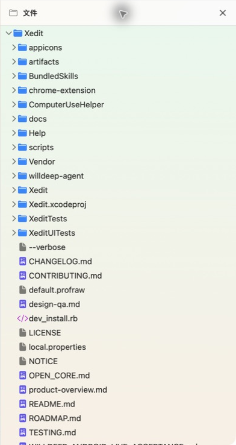
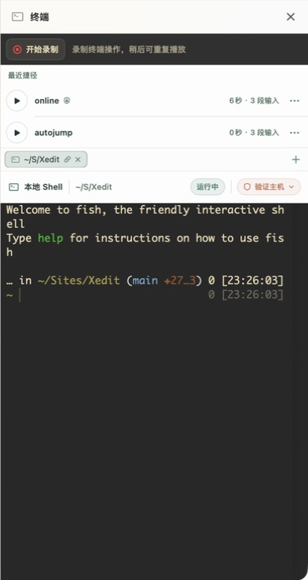

# 第 4 章：文件、终端、Diff 与侧栏

[上一章：模型、模式与审批](03-models-modes-approvals.md) · [返回索引](README.md) · [下一章：自动化与媒体](05-automation-media-extensions.md)

## 1. 文件侧栏

绑定工作区后，点击顶部“文件”打开工作区文件树：

常用操作：

- 展开文件夹，快速确认项目结构。
- 点击文本文件，在预览或编辑器中查看。
- 对照 Agent 最终回复检查交付物是否真的存在。
- 发现不相关目录时，不要为了“让 Agent 看得更多”扩大工作区根目录。

文件侧栏用于浏览，真正的变更审查应以 Diff 为准。

## 2. 终端侧栏

点击“终端”会打开与当前会话和工作区绑定的可见终端：

终端面板支持：

- 新建多个终端标签。
- 查看当前 shell、工作目录和运行状态。
- 绑定终端到当前会话，供 Agent 复用。
- 录制一段终端操作并稍后回放。
- 通过“验证主机”提醒核对本地或远端身份。

运行 SSH、数据库和部署命令前，先执行 `hostname`、`pwd` 和只读状态检查。终端标题叫“生产机”不等于它真的在生产机上，名字不会替你挡事故。

## 3. 终端录制与回放

1. 点击“开始录制”。
2. 在终端中完成需要复用的输入步骤。
3. 停止录制并命名捷径。
4. 回放前检查目标主机、工作目录和等待时间。

受保护输入只应在终端不回显时回放。不要把密码、Token 或一次性验证码录成普通明文捷径。

## 4. Diff 审查

点击顶部“Diff”查看当前工作树变化。建议按下面顺序检查：

1. 文件范围是否符合任务。
2. 新增和删除行数是否异常。
3. 是否误改生成文件、锁文件或用户已有改动。
4. 配置、迁移和接口是否同步更新。
5. 测试和文档是否覆盖变化。

如果 App 显示待应用补丁，可逐项 Apply 或 Reject。已有未提交改动时尤其要谨慎：不要把人类正在写的半首诗，当成 Agent 可以随手押韵的素材。

## 5. 预览

“预览”侧栏用于打开 Agent 产出的文件、图片、网页或其他交付物。检查时关注：

- 文件是否是最终版本而不是临时产物。
- 相对资源路径是否可加载。
- 页面在目标尺寸下是否正常。
- 图片、PDF、视频等二进制产物是否可实际打开。

## 6. 网页组件

当 Agent 或 Skill 调用 `show_widget` 后，生成的 HTML/SVG 组件会出现在网页组件面板：

适合展示交互式报告、小工具、图表和本地页面原型。网页组件不是自动部署；需要上线时仍要明确托管目标、权限和发布流程。

## 7. 任务与后台状态

运行构建、开发服务器、长命令或多步骤任务时，关注任务监控与活动状态：

- 运行中：仍在持续输出或等待结果。
- 需处理：等待审批、输入、补丁确认或错误恢复。
- 已完成：执行结束，但仍需检查结果是否通过验收。
- 失败：查看具体命令、退出码和上下文，不要只看红色图标。

当工具长时间无输出时，先读取当前状态和终端快照，再决定等待、重试或中止。
