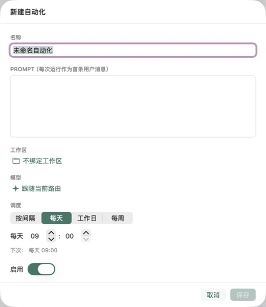
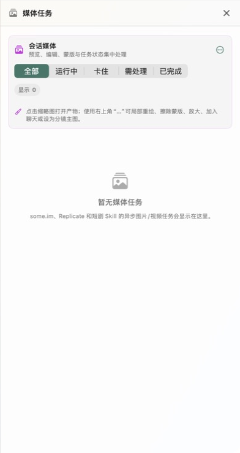
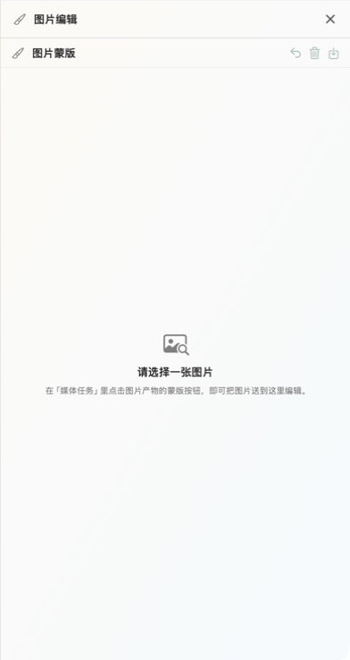
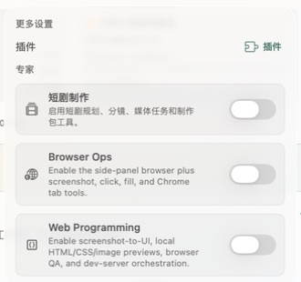

# 第 5 章：自动化、媒体任务、插件与专家

[上一章：侧栏与审查](04-side-panels-review.md) · [返回索引](README.md) · [下一章：内置编辑器](06-editor.md)

## 1. 创建自动化

点击左侧“自动化”旁的 `+`，会打开配置表单：



需要填写：

- 名称：用结果描述，例如“工作日代码仓库简报”。
- Prompt：每次运行时作为首条用户消息。
- 工作区：可不绑定，也可固定到本地或远端项目。
- 模型：跟随当前路由或指定稳定模型。
- 调度：按间隔、每天、工作日或每周。
- 启用：保存后是否立即进入调度。

只有 Prompt 有实际内容时“保存”按钮才会启用。

## 2. 自动化 Prompt 模板

```text
检查当前工作区过去 24 小时的 Git 变更与失败测试。

要求：
1. 只读，不修改文件，不提交，不推送。
2. 输出按“风险、需要跟进、仅供参考”分类。
3. 若没有异常，明确写“未发现异常”。
4. 结果控制在 500 字以内。
```

自动化必须明确副作用边界。定时运行的 Agent 没有凌晨三点突然获得“顺便发个版”的天命。

## 3. 自动化检查清单

- 调度频率是否会造成不必要的费用或负载。
- 工作区和远端 runtime 是否稳定可用。
- 模型是否支持任务需要的文件、图片或工具。
- 是否包含发布、发送或删除等必须人工批准的动作。
- 输出是否有固定格式，方便后续汇总。

## 4. 媒体任务

图片生成、视频生成、短剧 Skill 和部分第三方异步任务会进入“媒体任务”面板：



可以按“全部、运行中、卡住、需处理、已完成”筛选。点击产物缩略图可预览；右上角更多菜单通常提供局部重绘、擦除蒙版、放大、加入聊天或设为分镜主图等操作。

## 5. 图片蒙版编辑

在媒体任务中把图片发送到蒙版编辑器后，可以用图片编辑侧栏处理选区和笔迹：



基本流程：

1. 在媒体任务中选中图片产物。
2. 点击蒙版或编辑操作。
3. 在图片编辑面板绘制需要修改的区域。
4. 必要时撤销、清空或导出蒙版。
5. 把蒙版和编辑要求交回图片任务。

图片编辑侧栏处理的是“哪里要改”；“改成什么”仍应在提示词中写清楚。

## 6. 插件与专家

点击输入区底部的“更多”按钮，可以查看插件和专家：



专家用于按任务开启一组相关能力，例如：

- 短剧制作：规划、分镜、媒体任务和制作包。
- Browser Ops：侧栏浏览器、截图、点击、填写和 Chrome 标签工具。
- Web Programming：截图转界面、本地 HTML/CSS 预览、浏览器 QA 和开发服务器编排。

只在任务需要时启用专家。能力越多，上下文和可调用工具越多；全开并不会让 Agent 进化成八臂哪吒，只会让选择成本上升。

## 7. Skill、插件和 MCP 的区别

- Skill：一套可复用的任务说明、流程和资源。
- 插件：可以同时带来 Skill、MCP server 和 App/连接器能力。
- MCP：向 Agent 暴露外部工具或数据源的协议接口。
- 专家：在当前会话中启用某一类专门工具包和行为提示。

安装或启用前应确认来源、权限和数据去向。第三方连接器可能读取或写入外部系统，不应仅因为“能连上”就默认全部授权。
