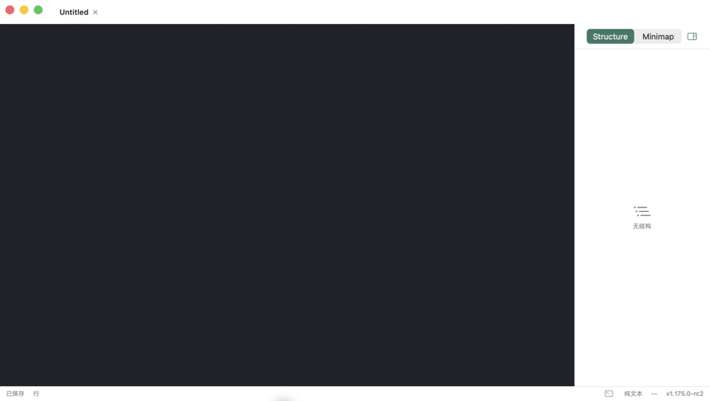
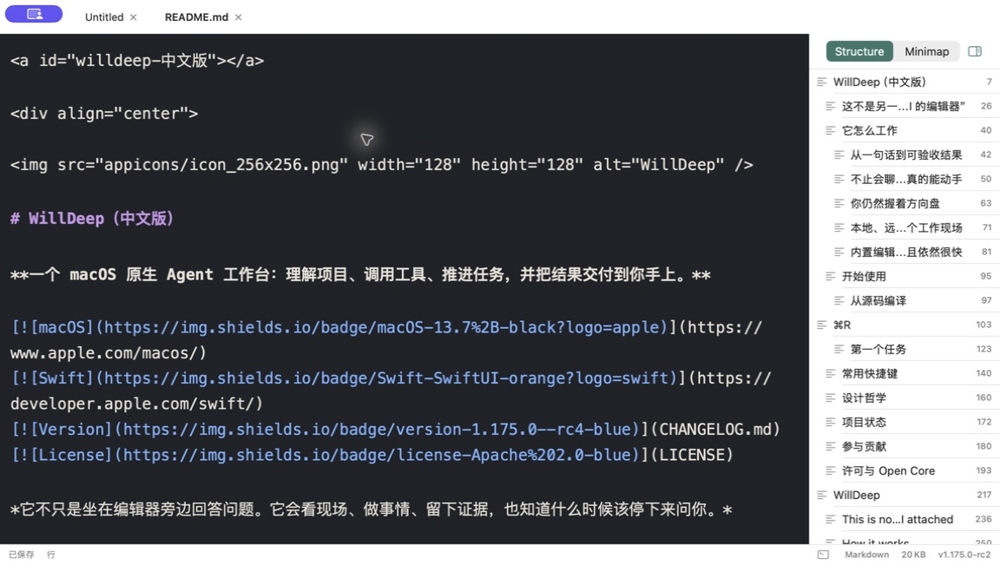
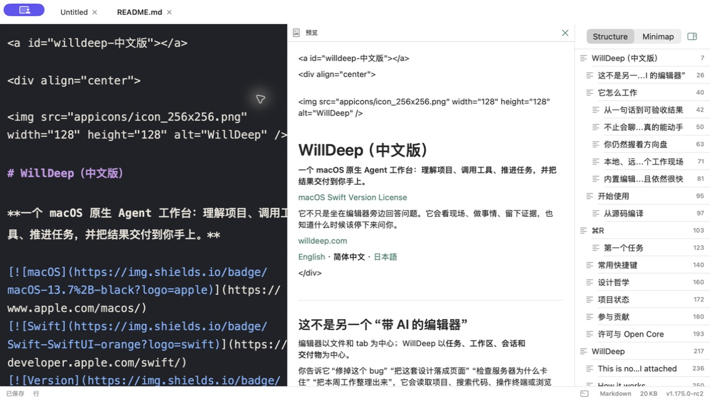

# 第 6 章：内置编辑器与 Markdown 预览

[上一章：自动化与媒体](05-automation-media-extensions.md) · [返回索引](README.md) · [下一章：设置与远端运行](07-settings-runtimes.md)

## 1. 打开内置编辑器

在 Agent 窗口中选择“显示 → 显示 Editor”。没有打开文件时，编辑器会创建一个 `Untitled` 标签：

Agent 是主工作台，编辑器用于直接查看、比较和轻量修改文件。两者可以随时切换。

## 2. 打开文件与文件夹

- `Command+O`：打开单个文件。
- `Shift+Command+O`：打开文件夹并加载文件树。
- `Command+P`：Quick Open，按名称快速定位文件。
- `Command+Shift+P`：命令面板。

只打开单个文件时，WillDeep 不会擅自扫描整个父目录；需要项目搜索、文件树和跨文件替换时，应显式打开文件夹。

## 3. 编辑器布局

打开文件后可见：

- 顶部标签：切换多个文件，关闭按钮位于标签右侧。
- 中央编辑区：语法高亮、查找、跳转、折叠和编辑。
- 右侧检查器：Structure 与 Minimap。
- 底部状态栏：保存状态、语言、文件大小和版本号。
- 终端按钮：显示或隐藏编辑器终端。

## 4. Structure 与 Minimap

- Structure：按标题、符号或文件结构跳转。
- Minimap：显示缩略代码视图，适合长文件快速定位。
- `Command+Shift+O`：跳到当前文件符号。
- `Command+L`：跳到指定行。
- `Command+Option+I`：切换检查器。

## 5. Markdown 与 HTML 预览

在 Markdown 或 HTML 文件中按 `Command+Option+R` 打开预览：

预览与源码并排显示，右侧 Structure 可按标题跳转。检查 Markdown 教程时重点关注：

- 图片相对路径是否正确。
- 标题层级是否连续。
- 表格、代码块和引用是否正常渲染。
- 本地链接是否指向存在的页面。

## 6. 查找、替换与标签

- `Command+F`：当前文件查找。
- `Command+G`：跳到下一个匹配。
- `Command+1…9`：切换对应标签。
- `Command+[` / `Command+]`：切换前后标签。
- `Command+Shift+T`：恢复刚关闭的标签。

跨文件替换前先缩小目录和文件类型范围，并检查替换预览。大规模替换应由 Git Diff 和测试兜底。

## 7. 分屏与专注模式

- `Command+Option+\`：在分屏中打开文件。
- 专注模式：隐藏无关界面，集中查看编辑内容。
- 分屏适合对照接口与实现、旧版与新版、源码与测试。

## 8. 保存与安全

- 注意标签和状态栏的未保存标记。
- 编辑用户已有脏文件前先确认 Diff。
- 不把 API Key、密码或私钥写入代码和教程。
- 大文件只优先处理可见范围；长日志建议用搜索和终端过滤，而不是整份塞进编辑器。
