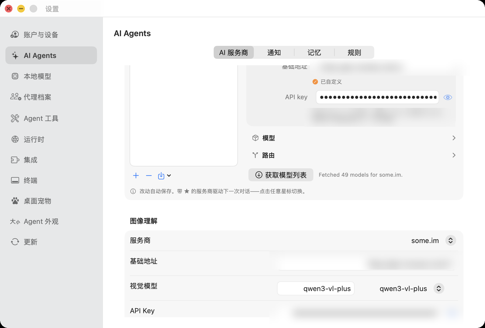

# 第 3 章 接入模型

没有模型，WillDeep 只是一个空壳。这一章把四条接入路径讲清楚，并给出一套够用的默认配置。

配置入口统一在「设置（⌘,）→ AI Agents → AI 服务商」，以及「设置 → 账户与设备 → some.im」。

## 3.1 四条路，先选一条

| 路径 | 适合谁 | 要准备什么 |
|---|---|---|
| **省心托管（some.im）** | 不想操心选哪个模型的人 | 一个 some.im 账号 |
| **自带 API Key** | 已经有 OpenAI / DeepSeek / Claude 等账号的人 | 对应服务商的 Key |
| **自定义服务商** | 用中转站、私有网关、公司内部代理的人 | 地址 + Key + 协议 |
| **本地模型** | 断网、涉密、或者想省钱的人 | 本机跑着 Ollama |

这四条可以同时配，随时在输入框的模型按钮里切。

## 3.2 省心托管：最省事的一条

1. 「设置 → 账户与设备 → some.im」，点"在浏览器打开"。
2. 浏览器里完成登录，页面提示可以继续后回到 WillDeep。
3. 回来应该看到"some.im 账号已连接"，下面显示账号和剩余积分。

**国内用户先看"区域"**：这一页可以选中国（`api.niuwoai.com`）、国际（`some.im`）或自定义。连不上、一直转圈，多半是区域选错了，不是账号问题。

登录之后，"新标签页默认模型"有两个选择：

- **省心托管**：新会话默认交给托管路由，由它按任务挑模型。你随时能在输入区手动改。
- **DeepSeek V4 Flash**：新会话固定用这个具体模型。

托管路由的工作方式值得了解一下，因为它会影响你的花费和体验：每一轮请求之前，客户端先用一个轻量裁判模型判断这次是编程任务还是通用任务、复杂度多高，再决定本轮实际用哪个档位的模型。输出如果出现重复循环、空回复或者被截断，会自动升档重试；同一个会话内**只升不降**。

托管也不是只能听天由命：输入框的模型按钮里有一个托管档位菜单，可以手动挑 Flash / Pro / Premium，挑过之后按钮上会显示成"省心托管 · Pro"这样。默认是自动判定，遇到难题又不想等它自己升档时，直接挑 Pro。

发给托管的请求带两个标识头：一个会话 ID、一个工作区 ID。工作区 ID 是本机随机生成的，不是你的真实路径。裁判请求和日志里不放本地路径、用户名、API Key 和 session token。

退出登录会影响本机所有共享这份登录的 App，弹窗里会提示你。

## 3.3 自带 API Key

「设置 → AI Agents → AI 服务商」，左边是服务商库，点 `+` 添加一个。



（上图里的地址和备注已打码；API Key 在界面上本来就是掩码显示。）

内置预设覆盖了常见的几家：

| 预设 | 默认地址 | 协议 |
|---|---|---|
| OpenAI / OpenAI Responses | `https://api.openai.com/v1` | OpenAI Chat / Responses |
| Claude | `https://api.anthropic.com` | Anthropic Messages |
| Google Gemini | `https://generativelanguage.googleapis.com` | Gemini |
| DeepSeek | `https://api.deepseek.com` | OpenAI Chat |
| DashScope（阿里） | `https://dashscope.aliyuncs.com/compatible-mode/v1` | OpenAI Chat |
| Kimi | `https://api.moonshot.cn/v1` | OpenAI Chat |
| Moonshot | `https://api.moonshot.cn/v1` | OpenAI Chat |
| OpenRouter | `https://openrouter.ai/api/v1` | OpenAI Chat |
| AnyRouter | `https://anyrouter.top/v1` | OpenAI Chat |
| SiliconFlow（硅基流动） | `https://api.siliconflow.cn/v1` | OpenAI Chat |
| some.im | `https://some.im/v1` | OpenAI Chat |
| Ollama / Local OpenAI | `http://127.0.0.1:11434/v1` | OpenAI Chat |
| Custom | 自己填 | 自己选 |

填完 API Key 之后，点"获取模型列表"验证连通性，然后在"模型"分组里选主模型。

几条容易卡住的地方：

- **地址少了 `/v1`**：探测成功后界面会直接问你"要将 /v1 补入基础地址吗"，点一下就好。
- **改动自动保存**，但带 ★ 的那个服务商才是下一次对话实际用的，点星标切换。
- **API Key 存在 macOS 钥匙串**，不写进任何配置文件。
- DeepSeek 不支持直接读图。要让 Agent 看图，得配下面的"图像理解"。

## 3.4 路由档位：Auto / Flash / Pro

每个服务商的"路由"分组里有个默认档位：

- **Auto**：成本优先。Agent 回合和上下文压缩默认走 Flash，除非会话里另外指定。
- **Flash**：固定用便宜快的那个。
- **Pro**：固定用强的那个。

日常建议 Auto。遇到难题在会话里手动切到 Pro，做完切回来。

## 3.5 几个辅助模型，配一下能省不少钱

这几项都在 AI 服务商页里，留空都有兜底，但配一下体验更好：

| 设置 | 作用 | 建议 |
|---|---|---|
| **图像理解** | 主模型不能读图时，先让另一个视觉模型把图描述出来再转给主模型 | 主模型不支持图片时必配 |
| **对话标题** | 用一次性短补全把对话压成 12 字以内的标题 | 指一个便宜快的模型，别用 Pro 起标题 |
| **上下文压缩** | 上下文满了之后摘要较早的对话 | **按窗口大小挑，不是按速度挑；不要用推理模型**，摘要被截断会静默丢状态 |
| **Web 工具** | 内置联网搜索用哪家 | 填 Exa 或 Brave 的 Key；都不填且登录了 some.im 就走托管搜索 |

## 3.6 并发上限

同一页最下面有"每个服务商的并发上限"，默认 **3**，可调 1–8。

它管的是同一个服务商能同时跑几个 Agent 回合。配额按服务商独立算——三个 DashScope 会话跑满，不会挡住 OpenAI 的会话。超了的请求排队，先来后到。调小只影响新任务，正在跑的回合不会被打断。

另有"Anthropic 回复上限"，默认 32768，管单次回复能生成多少 token。

## 3.7 本地模型

「设置 → 本地模型」。前提是你本机已经用 Ollama 之类的工具把模型跑起来了——WillDeep 不负责下载和管理模型。

填两样：本地 Endpoint（默认 `http://127.0.0.1:11434/v1`）、模型名（图片理解模型和 LLM 模型各一个）。

然后是几个"先用本地"的开关：

- 图片识别先用本地
- 会话标题先用本地
- 上下文压缩先用本地 —— **默认不开**，因为小模型压长上下文容易压坏
- Worker 派发判断先用本地 —— 只支持本机 Ollama

还有一个"启动时预热并常驻内存"：开了之后启动就加载模型，每 4 分钟续一次驻留，免得 Ollama 五分钟后把它卸载掉。代价是一直占内存。

勾上"加入 composer 模型备选"，本地模型会出现在模型菜单里，断网时能手动切过去接着聊。

本地这条路的现实预期：**小模型做辅助活（起标题、判断派发、看图）够用，做主力干活会让你反复失望**。

## 3.8 一套够用的默认配置

```
主力：some.im 省心托管，或者你已有账号的那家 + Auto 档
图像理解：配一个视觉模型（主模型不支持读图时）
对话标题：一个便宜的小模型
上下文压缩：一个窗口大的非推理模型
并发：3
本地模型：装了 Ollama 就开，只勾"图片识别"和"会话标题"
```

## 本章检查点

- [ ] 输入框的模型按钮里能看到你配的模型
- [ ] 点"获取模型列表"能成功拉到列表
- [ ] 你知道 API Key 存在钥匙串，不在配置文件里
- [ ] 你知道压缩模型不该选推理模型

---

← 上一章 [第 2 章 安装、升级与首次启动](02-install-and-first-run.md) · 返回 [目录](README.md) · 下一章 → [第 4 章 界面地图](04-interface-map.md)
