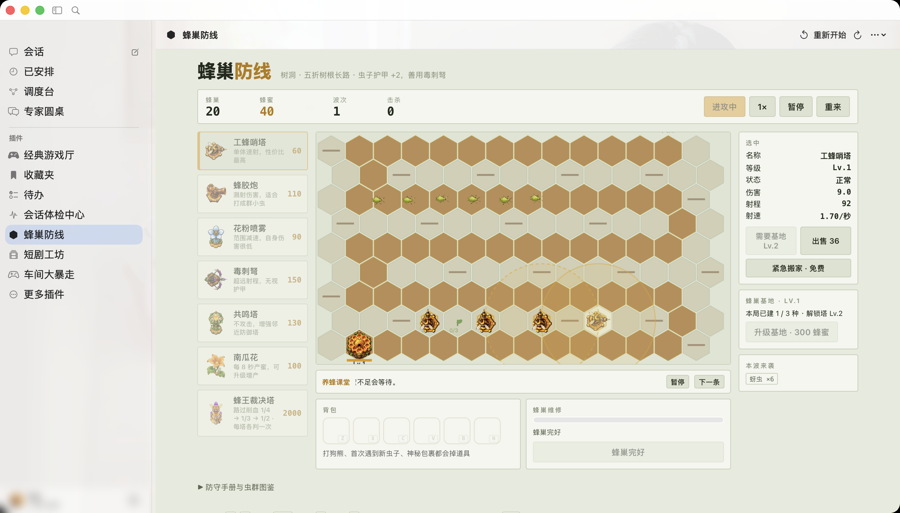
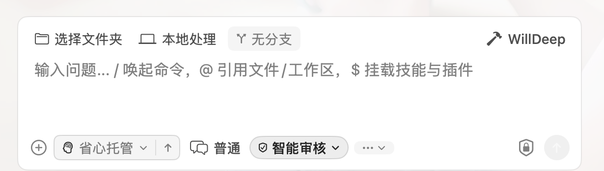

# 第 4 章 界面地图

这一章带你把界面上每一块都认一遍。后面所有章节都会引用这里的名字。

先说一句能省你很多时间的话：**这个版本的 WillDeep 是 Agent 专用应用**，没有可以打开的通用文本编辑器。文件面板是只读预览，改动由 Agent 提交、你在"审阅"里过目后应用。想直接手改文件，用你自己顺手的编辑器（官方配套的是独立的 Qeditor）。

## 4.1 主窗口：三栏

```
┌──────────────┬────────────────────────────┬───────────────┐
│  会话侧边栏    │        对话主列              │   工作面板     │
│              │                            │               │
│ 导航 / 插件    │  会话标题 + 面板图标条         │ 标签条         │
│ 待你处理       │  ─────────────────         │ ────────      │
│ 置顶          │  对话正文（转录）             │ 文件 / 终端    │
│ 工作区分组     │  ─────────────────         │ 审阅 / 浏览器   │
│ 会话列表       │  输入区（Composer）          │ …             │
│ 账户页脚       │  状态栏                     │               │
└──────────────┴────────────────────────────┴───────────────┘
   230–520pt          可压缩，自适应               320–760pt
```

两条分隔线都能拖。侧边栏可以用 **⌘\\** 整个收起；收起后靠左边缘会留一条"最近聊天"的细轨，鼠标挪过去就能切会话。

窗口最小尺寸是 720×480。第一次启动时窗口大小是屏幕可见区域的八成，之后你自己调的大小会被记住。

## 4.2 左栏：会话侧边栏

自上而下：

**① 主导航（四项）**

| 项 | 作用 |
|---|---|
| **会话** | 回到对话界面。这一行尾部的铅笔图标是"新聊天" |
| **已安排** | 定时任务列表（[第 14 章](14-automation.md)） |
| **调度台** | 多任务节点看板（[第 14 章](14-automation.md)） |
| **专家圆桌** | 多角色讨论（[第 14 章](14-automation.md)） |

**② 插件**
已固定在侧栏的插件各占一行，右键可以取消固定或进设置。最后两行是"添加插件…"和"更多插件"，后者进插件中心（[第 13 章](13-extensions.md)）。

**③ 等你处理**
有会话在等你审批或回答问题时，这个分区会出现，点一下直接跳过去。手上开着十几个会话时，这是最有用的一栏。

**④ 置顶**

**⑤ 工作区分组**
会话按工作区自动归组。每组默认显示 5 条，多了折起来，点"查看更多"展开。组内还有独立的"已归档"子分区。组标题右键能新建聊天、置顶项目、编辑项目、升级为项目。

**⑥ 会话行**
行上会出现这些标记：未读圆点、"待处理"徽标、定时任务徽标、Git 工作树徽标、计划或目标的进度提示。鼠标悬停有置顶和归档的快捷按钮，右键菜单很长（重命名、归档、复制会话 ID、复制深度链接、在新聊天中继续、在新工作树中继续、在新窗口中打开转录、用 AI 总结标题、删除会话……）。

下图是侧边栏的样子，主列里打开的是一个插件页面（内置的"蜂巢防线"）：



**⑦ 账户页脚**
显示 some.im 账号和剩余点数，菜单里有刷新点数、显示/隐藏桌面宠物、设置（⌘,）、退出登录、WillDeep 帮助。有新版本时这里会多一张更新卡。

## 4.3 中栏：对话

**会话标题行**
左边是标题，右边是一条面板图标条——每个图标对应一个工作面板，点一下开，再点一下关。媒体任务的图标会带计数提示，例如"媒体任务 · 2 需处理"。最右边那个爪印是桌面宠物开关。

**转录（对话正文）**
你的消息、Agent 的回复、工具卡、计划卡、审批卡都在这里按时间排列。**⌘F** 可以在当前会话内搜索，Esc 关掉搜索条。

每条消息底部有"复制消息"；Agent 的消息还会显示 token 统计和缓存比例。

**输入区（Composer）**
下一节单独讲。

**状态栏**
最底下一行，左边是当前状态（正在思考 / 正在排队，等待空闲的并发槽位 / 已包含当前文件 · 工具可用……），右边是上下文占用环和"压缩"按钮（[第 16 章](16-context-and-cost.md)）。

## 4.4 输入区详解



**输入框上方一行：这次任务在哪儿跑**

| 控件 | 说明 |
|---|---|
| 工作区选择器 | 显示当前文件夹名，没选时是"选择文件夹"。菜单里能切工作区、管理 Git worktree、选远程运行环境 |
| 运行位置 | "本地处理"或"新工作树" |
| 分支胶囊 | 只读，显示当前 Git 分支，没有则显示"无分支" |
| 执行器 | 这一轮由 WillDeep 自己执行，还是交给本机的外部 CLI（Claude Code、Codex 等，见[第 13 章](13-extensions.md)） |

**输入框本身**

占位文字写着：输入问题... / 唤起命令，`@` 引用文件/工作区，`$` 挂载技能与插件。三个触发符各有一个弹出面板：

- `/` —— 斜杠命令（完整清单见[附录 A](appendix-a-shortcuts.md)）
- `@` —— 引用文件、引用整个工作区（`@workspace`）、点名某个 Worker（`@scout` 等）
- `$` —— 挂载技能

选中条目后，那个 token 会从输入框里消失，变成输入框上方的一个 chip。真正的内容在你按发送时才拼进去。

键盘：**Return** 发送，**Shift/Option/Control + Return** 换行。输入框为空时按 **↑** 可以翻出自己发过的历史消息。

**输入框下方一行：这次任务怎么跑**

四个常驻控件，从左到右是模型、任务模式、审批模式、更多设置（`…⌄`）。

- 模型：[第 3 章](03-models-and-providers.md)。选了外部执行器时这个按钮会整个消失，因为那时模型由外部 CLI 决定。
- 任务模式：普通 / 目标，见[第 7 章](07-task-modes.md)。
- 审批模式：四档，见[第 8 章](08-approvals-and-sandbox.md)。
- 更多设置：里面是"默认使用沙箱"开关和"执行优先级"（子 Agent 优先 / Agent 优先），外加插件挂在这里的命令。

**底部动作行**

回形针（附加图片或文档，单个上限 50 MB）、排队徽章（正在响应时你又发了消息，会排队）、"插入受保护机密"、发送按钮。Agent 正在响应时，发送按钮变成一个方块，就是停止。

## 4.5 右栏：工作面板


右栏顶部是标签条，标题叫"工作面板"。➕ 菜单能新建本地 Shell、连已配置的 SSH 主机、开浏览器，以及打开其余面板。

标签可以拖动排序，也可以**拖出来变成独立窗口**——终端进程和网页状态都跟着走，不会重启。分离出去之后，用标签条右侧的网格按钮打开概览，能一键"收回侧栏"或"收回所有窗口"。

面板一共这些（部分需要装对应技能包才出现）：

| 面板 | 做什么 | 详见 |
|---|---|---|
| 文件 | 只读浏览工作区文件树，带 Git 状态标记 | [第 9 章](09-panels.md) |
| 预览 | 渲染 Markdown 和 HTML | [第 9 章](09-panels.md) |
| 审阅 | 看 Diff、提交、推送 | [第 10 章](10-review-and-commit.md) |
| 终端 | 真实终端，多标签，可连 SSH | [第 9 章](09-panels.md) |
| 浏览器 | 内置浏览器，可截图 | [第 9 章](09-panels.md) |
| 后台任务 | 看 / 停 后台进程 | [第 11 章](11-multi-agent.md) |
| 媒体任务 | 图片视频生成任务与产物 | [第 12 章](12-media-and-workshops.md) |
| 图片编辑 | 图片蒙版标注，送去重绘或擦除 | [第 12 章](12-media-and-workshops.md) |
| 网页组件 | Agent 生成的网页小组件 | [第 9 章](09-panels.md) |
| 计划 | 完整计划（不截断），仅当前会话有计划时出现 | [第 7 章](07-task-modes.md) |
| Dev Server | 前后端启动命令与日志（需"Web 编程"技能包） | [第 9 章](09-panels.md) |
| 短剧 | 短剧项目结构（需"短剧制作"技能包） | [第 12 章](12-media-and-workshops.md) |

有一条提示写在面板底部，值得记住：**关闭标签不会停止正在运行的终端或任务**。要停，去后台任务面板或终端里显式停。

## 4.6 菜单栏与快捷键

菜单栏很薄，因为这版把编辑器相关的菜单都撤了。实际有用的自定义项只有五个：

| 快捷键 | 作用 |
|---|---|
| **⌘N** | 新聊天 |
| **⌘,** | 设置 |
| **⌘?** | WillDeep 帮助（应用内置的帮助书） |
| **⌘\\** | 显示 / 隐藏会话侧栏 |
| **⇧⌘P** | 搜索会话与项目 |

其余是 macOS 默认项。输入框、面板内部还有一批上下文相关的键（⌘F 转录搜索、⌘↩ 提交 Diff 等），完整清单见[附录 A](appendix-a-shortcuts.md)。

## 本章检查点

- [ ] 你能说出三栏各自放什么
- [ ] 你知道 `/`、`@`、`$` 分别唤起什么
- [ ] 你能把一个面板拖成独立窗口再收回来
- [ ] 你记住了"关闭标签不等于停止任务"
- [ ] 你知道这一版没有内置的通用编辑器

---

← 上一章 [第 3 章 接入模型](03-models-and-providers.md) · 返回 [目录](README.md) · 下一章 → [第 5 章 工作区与会话](05-workspaces-and-sessions.md)
