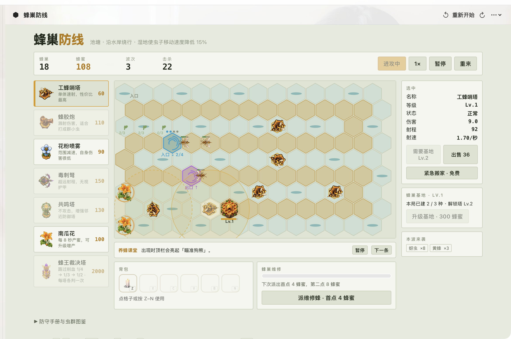

# 第 12 章 媒体任务、图片蒙版与创作工坊

这一章讲代码之外的部分。如果你只用 WillDeep 写程序，可以跳过——但里面有几个工具（图片处理斜杠命令、图片蒙版）即使做技术工作也用得上。

## 12.1 先配好模型

「设置 → 账户与设备 → some.im」下面两项：

- **图片生成** —— 填首选模型列表，英文逗号分隔。配了 some.im 之后默认用 `gpt-image-2`。
- **视频生成** —— 异步视频任务用的首选模型列表。

另外，图片放大、擦除、蒙版重绘这类能力可以走 Replicate：「设置 → 集成 → Replicate」填 Token，Token 存在钥匙串里。

## 12.2 不需要模型的图片处理：斜杠命令

这一批是本机跑的，用的是 macOS 自己的图像和视觉能力，不花钱、不联网、不需要装 ImageMagick：

| 命令 | 作用 |
|---|---|
| `/image-convert` | 转格式（png / jpeg / webp / tiff / heic） |
| `/image-resize` | 改尺寸 |
| `/image-crop` | 裁剪，支持 square、16:9、9:16、4:3 预设 |
| `/image-compress` | 压到指定大小 |
| `/image-bg-remove` | 按颜色抠背景 |
| `/image-trim-pad` | 裁白边、加留白 |
| `/image-watermark` | 加文字水印 |
| `/image-ocr` | 提取图中文字 |
| `/image-redact` | 打码：人脸、文字、邮箱电话等模式 |
| `/image-contact-sheet` | 多图拼成联系表 |
| `/image-palette` | 提取主色 |
| `/image-compare` | 两图对比 |
| `/image-alt-text` | 生成替代文本 |

视频那一组（`/video-compress`、`/video-extract`、`/video-thumbnail`、`/video-merge`、`/video-watermark`、`/video-speedup`）靠 ffmpeg，产物写到 `~/Downloads/`。

发截图给别人之前先 `/image-redact` 打个码，是个值得养成的习惯。

## 12.3 媒体任务面板

生成图片和视频是**异步任务**：提交之后在后台跑，好了才有结果。这个面板就是它们的集中管理处。

**筛选**：运行中 / 卡住 / 需处理 / 已完成 / 全部。

**批量操作**：刷新卡住的任务、刷新运行中的、发送状态到聊天、重试失败任务。

**单个任务**：立即刷新状态、取消远端任务、把重试请求发到聊天、基于分镜图片继续生成视频。

**产物的"…"菜单**（这是最常用的一组）：

- **局部重绘** —— 打开图片蒙版面板，见下一节
- **加入聊天附件** —— 把这张图带回对话，让 Agent 接着处理
- **用 Replicate 放大**
- **设为分镜主图** —— 短剧项目里用

任务"卡住"是常态，远端服务排队、超时都会这样。先点"立即刷新任务状态"，还不行就取消重来。

## 12.4 图片蒙版：局部重绘和擦除

入口不在标签条上，而是在媒体任务面板里点图片产物的蒙版按钮。面板标题叫"图片蒙版"。

**怎么用**：

1. 用**矩形**或**画笔**圈出要动的区域（画笔有"添加"和"橡皮"两种模式）。
2. 选**模式**：局部重绘（在选区里重新生成）或擦除（把选区里的东西抹掉）。
3. 需要的话勾"反选蒙版"——选区变成"选区之外"，适合保留主体、只重画背景。
4. 选服务：Replicate 或 some.im，各自填好 version / endpoint / token。
5. 点"提交重绘"或"提交擦除"，任务回到媒体任务面板里跟踪。

说清楚它的定位：**这不是通用图片编辑器**，它只做一件事——标出区域，交给 AI 重画或抹掉。要调色、要图层、要精修，用别的工具。

## 12.5 短剧工坊

这是随 App 发行的一个完整插件（短剧工坊），从策划到分镜到成片素材的一条生产线。侧边栏"短剧工坊"进去。

大致流程：

1. **策划**：和 AI 多轮聊，聊出题材、人物、主线，输出结构化的短剧规划。
2. **角色定妆**：给每个角色生成定妆图，后面的分镜靠它保持形象一致。
3. **分集剧本**：一集一集写，台词可编辑。
4. **分镜**：从剧本生成初始分镜，每个镜头有描述、首帧和尾帧的独立提示词。
5. **生成**：批量生成分镜图片，挑一张满意的当主图，再从图生视频。
6. **导出制作包**。

工坊的创作技能（策划、角色设定、多集串联、单集剧本、局部改写、分镜，另加去 AI 味、言情、穿越重生三份通用技能）都可以在设置里查看和改写，改完对下一次生成生效。恢复内置版本是一个显式操作，不会随插件更新静默覆盖你改过的内容。

对应地，右栏还有一个"短剧"面板（需要"短剧制作"技能包），显示项目的结构：集数、分镜、人物、场景，以及每一集的媒体任务和制作缺口。

## 12.6 内置的离线游戏

插件中心里有几个不花一分钱、不联网、不调模型的东西：

- **蜂巢防线** —— 塔防。选花园 / 树洞 / 池塘三张图，十类虫群，塔可以升级，有传送门、狗熊拆塔、蜂蜜经济和基地等级。
- **车间大暴走** —— 三分钟漫画风追逐游戏，躲 AI 班长，投掷、冲刺、纸箱躲藏、收集通行章逃出。
- **经典游戏厅** —— 十款经典街机小游戏。
- **俄罗斯方块** —— 示例插件，也是插件开发的参考实现。

它们零权限、完整资源随 App 携带，不喜欢可以在插件中心停用，也不会强制固定在侧栏。

## 12.7 网页组件：让结果好看一点

Agent 有一个展示组件的能力，能把结果渲染成图表、表格、对比卡片这类小页面，直接出现在对话里和"网页组件"面板中。

让它出这种东西的说法很简单："把这份统计画成图表给我看。"

组件跑在严格沙箱里：没有网络、不能导航、不能访问文件、外部脚本和样式都被拦住。组件上的按钮也不能直接执行工具，只能把意图交回给 Agent 走正常审批。所以你看到的组件一定是自包含的，也一定是安全的。

## 本章检查点

- [ ] 你用一条 `/image-*` 命令处理过一张图
- [ ] 你在媒体任务面板里看过一个任务的完整生命周期
- [ ] 你用蒙版做过一次局部重绘或擦除
- [ ] 你知道网页组件跑在无网络的沙箱里

---

← 上一章 [第 11 章 多 Agent 协作](11-multi-agent.md) · 返回 [目录](README.md) · 下一章 → [第 13 章 扩展生态](13-extensions.md)
